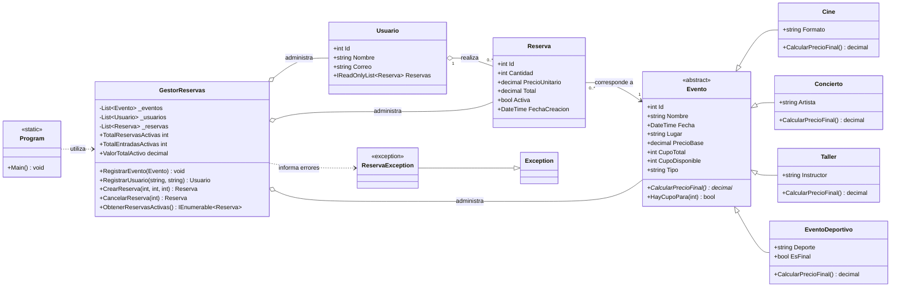

# PLANAZO

### Gestión de eventos y reservas en C# · .NET 8

Aplicación de consola para administrar eventos, usuarios y reservas. El proyecto aplica principios de programación orientada a objetos y separa la interacción con el usuario de las reglas del dominio.

---

## Características

- Consulta de eventos y búsqueda por tipo.
- Registro de usuarios.
- Creación y cancelación de reservas.
- Control de disponibilidad para evitar sobreventas.
- Consulta de reservas por usuario y resumen de actividad.
- Precios calculados mediante polimorfismo según el tipo de evento.
- Validación de operaciones con excepciones de dominio.

## Requisitos

- [.NET SDK 8](https://dotnet.microsoft.com/download/dotnet/8.0)

## Ejecución

Desde la carpeta del proyecto:

```bash
dotnet run
```

Al iniciar, PLANAZO carga eventos y usuarios de demostración y presenta un menú interactivo:

| Opción | Acción |
|:--:|---|
| 1 | Consultar todos los eventos |
| 2 | Consultar eventos por tipo |
| 3 | Registrar usuario |
| 4 | Crear una reserva |
| 5 | Cancelar una reserva |
| 6 | Ver las reservas de un usuario |
| 7 | Consultar el resumen de reservas activas |
| 0 | Salir |

## Reglas de precios

Cada tipo de evento implementa `CalcularPrecioFinal()` con su propia regla:

| Tipo | Cálculo | Ejemplo con precio base de $100.000 |
|---|---|---:|
| Cine | Precio base | $100.000 |
| Concierto | Precio base + 15 % | $115.000 |
| Taller | Precio base − 10 % | $90.000 |
| Deportivo | Precio base + 5 % de seguridad; suma 20 % adicional si es final | $105.000 / $125.000 |

Los importes se representan con `decimal`. El formato de números mostrado puede variar según la configuración regional del sistema.

## Diseño

`Evento` define el estado y comportamiento común de los eventos. Sus subclases especializan la regla de precio; `GestorReservas` coordina las operaciones del dominio, y `Program` se ocupa del menú y la entrada/salida por consola.



El diagrama también está disponible como archivo independiente: [`Diagrama.mmd`](Diagrama.mmd).

### Principios de diseño aplicados

- **Abstracción y herencia:** `Evento` concentra los datos y reglas compartidas; cada tipo concreto define su comportamiento específico.
- **Polimorfismo:** los precios se calculan desde el tipo de evento sin ramificar la lógica del gestor.
- **Encapsulamiento:** los cupos, el estado de una reserva y la colección de reservas de un usuario se modifican mediante operaciones controladas.
- **Separación de responsabilidades:** `Program` gestiona la consola y `GestorReservas` contiene las operaciones del dominio.
- **Precio de reserva estable:** cada reserva conserva el precio unitario calculado al crearla.

## Estructura del proyecto

```text
PLANAZO/
├── Planazo.csproj
├── Program.cs
├── Diagrama.mmd
├── Cine.cs
├── Concierto.cs
├── Evento.cs
├── EventoDeportivo.cs
├── GestorReservas.cs
├── Reserva.cs
├── ReservaException.cs
├── Taller.cs
└── Usuario.cs
```

Los espacios de nombres agrupan el código en `Planazo.Modelos` y `Planazo.Servicios`, aunque los archivos se mantienen en la raíz del proyecto.
